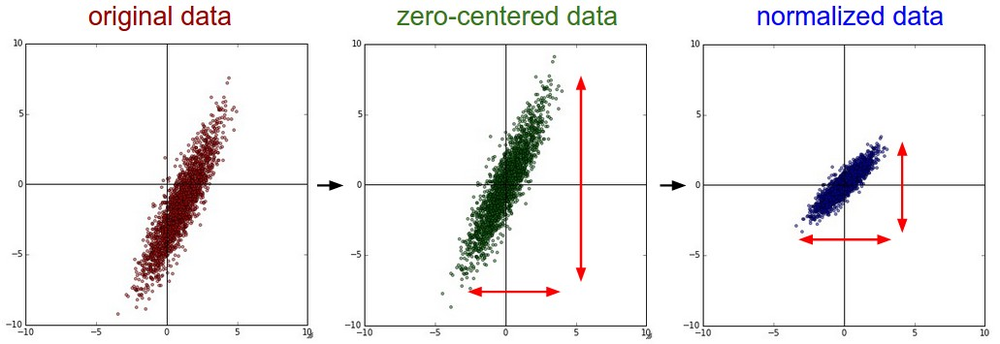
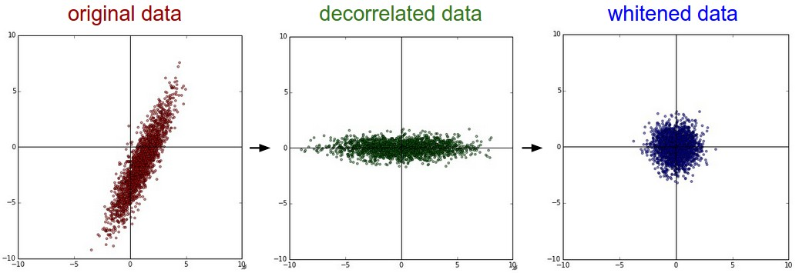
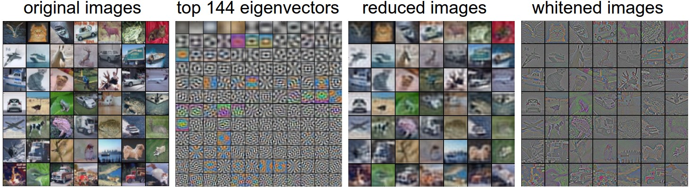
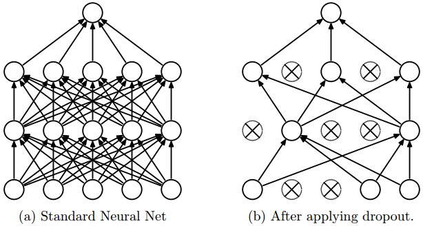

# 神经网络 2：数据预处理、初始化、正则化与损失

[英文原文](neural-networks-2.md) · [逐步学习指南](../../docs/CS231n_2025_逐步学习实践指南.md)

> 本地中文整理版（2026-11-05）：以仓库英文课程笔记为对照，参考智能单元社区译稿，统一了本地插图、公式与代码示例。函数名、变量名、论文标题及示例代码中的英文注释保留，便于查文档和对照作业。原笔记包含早期课程的经验与工具，历史建议不等同于 2025 年作业环境要求。

## 本文目录

- [设置数据和模型](#section-01)
- [数据预处理](#section-02)
- [权重初始化](#section-03)
- [正则化](#section-04)
- [损失函数](#section-05)
  - [单标签分类](#section-06)
  - [属性分类与多标签分类](#section-07)
  - [回归](#section-08)
  - [结构化预测](#section-09)
- [小结](#section-10)

<a id="intro"></a>

<a id="section-01"></a>

## 设置数据和模型

在上一节中介绍了神经元的模型，它在计算内积后进行非线性激活函数计算，神经网络将这些神经元组织成各个层。这些做法共同定义了 **评分函数（score function）** 的新形式，该形式是从前面线性分类章节中的简单线性映射发展而来的。具体来说，神经网络就是进行了一系列的线性映射与非线性激活函数交织的运算。本节将讨论更多的算法设计选项，比如数据预处理，权重初始化和损失函数。

<a id="datapre"></a>

<a id="section-02"></a>

## 数据预处理

关于数据预处理我们有3个常用的符号，数据矩阵 **X**，假设其尺寸是[**N x D]**（**N**是数据样本的数量，**D**是数据的维度）。

**均值减法（**Mean subtraction**）** 是预处理最常用的形式。它对数据中每个独立_特征_减去平均值，从几何上可以理解为在每个维度上都将数据云的中心都迁移到原点。在numpy中，该操作可以通过代码 **X -= np.mean(X, axis=0)** 实现。而对于图像，更常用的是对所有像素都减去一个值，可以用 **X -= np.mean(X)** 实现，也可以在3个颜色通道上分别操作。

**归一化（**Normalization**）** 是指将数据的所有维度都归一化，使其数值范围都近似相等。有两种常用方法可以实现归一化。第一种是先对数据做零中心化（zero-centered）处理，然后每个维度都除以其标准差，实现代码为 **X /= np.std(X, axis=0)** 。第二种方法是对每个维度都做归一化，使得每个维度的最大和最小值是1和-1。这个预处理操作只有在确信不同的输入特征有不同的数值范围（或计量单位）时才有意义，但要注意预处理操作的重要性几乎等同于学习算法本身。在图像处理中，由于像素的数值范围几乎是一致的（都在0-255之间），所以进行这个额外的预处理步骤并不是很必要。



一般数据预处理流程：**左边：** 原始的2维输入数据。**中间：** 在每个维度上都减去平均值后得到零中心化数据，现在数据云是以原点为中心的。**右边：** 每个维度都除以其标准差来调整其数值范围。红色的线指出了数据各维度的数值范围，在中间的零中心化数据的数值范围不同，但在右边归一化数据中数值范围相同。

**PCA和白化（**Whitening**）** 是另一种预处理形式。在这种处理中，先对数据进行零中心化处理，然后计算协方差矩阵，它展示了数据中的相关性结构。

```python
# Assume input data matrix X of size [N x D]
X -= np.mean(X, axis = 0) # zero-center the data (important)
cov = np.dot(X.T, X) / X.shape[0] # get the data covariance matrix
```

数据协方差矩阵的第(i, j)个元素是数据第i个和第j个维度的_协方差_。具体来说，该矩阵的对角线上的元素是方差。还有，协方差矩阵是对称和[半正定](https://en.wikipedia.org/wiki/Positive-definite_matrix#Negative-definite.2C_semidefinite_and_indefinite_matrices)的。我们可以对数据协方差矩阵进行SVD（奇异值分解）运算。

```python
U,S,V = np.linalg.svd(cov)
```

U的列是特征向量，S是装有奇异值的1维数组（因为cov是对称且半正定的，所以S中元素是特征值的平方）。为了去除数据相关性，将已经零中心化处理过的原始数据投影到特征基准上：

```python
Xrot = np.dot(X, U) # decorrelate the data
```

注意U的列是标准正交向量的集合（范式为1，列之间标准正交），所以可以把它们看做标准正交基向量。因此，投影对应x中的数据的一个旋转，旋转产生的结果就是新的特征向量。如果计算**Xrot**的协方差矩阵，将会看到它是对角对称的。**np.linalg.svd** 的一个良好性质是在它的返回值 **U** 中，特征向量是按照特征值的大小排列的。我们可以利用这个性质来对数据降维，只要使用前面的小部分特征向量，丢弃掉那些包含的数据没有_**方差**_的维度。 这个操作也被称为主成分分析（ [Principal Component Analysis](http://en.wikipedia.org/wiki/Principal_component_analysis) 简称PCA）降维：

```python
Xrot_reduced = np.dot(X, U[:,:100]) # Xrot_reduced becomes [N x 100]
```

经过上面的操作，将原始的数据集的大小由[N x D]降到了[N x 100]，留下了数据中包含最大_**方差**_的100个维度。通常使用PCA降维过的数据训练线性分类器和神经网络会达到非常好的性能效果，同时还能节省时间和存储器空间。

最后一个在实践中会看见的变换是**白化（**whitening**）**。白化操作的输入是特征基准上的数据，然后对每个维度除以其特征值来对数值范围进行归一化。该变换的几何解释是：如果数据服从多变量的高斯分布，那么经过白化后，数据的分布将会是一个均值为零，且协方差相等的矩阵。该操作的代码如下：

```python
# whiten the data:
# divide by the eigenvalues (which are square roots of the singular values)
Xwhite = Xrot / np.sqrt(S + 1e-5)
```

_警告：夸大的噪声_。注意分母中添加了1e-5（或一个更小的常量）来防止分母为0。该变换的一个缺陷是在变换的过程中可能会夸大数据中的噪声，这是因为它将所有维度都拉伸到相同的数值范围，这些维度中也包含了那些只有极少差异性(方差小)而大多是噪声的维度。在实际操作中，这个问题可以用更强的平滑来解决（例如：采用比1e-5更大的值）。



PCA/白化。**左边**是二维的原始数据。**中间**：经过PCA操作的数据。可以看出数据首先是零中心的，然后变换到了数据协方差矩阵的基准轴上。这样就对数据进行了解相关（协方差矩阵变成对角阵）。**右边**：每个维度都被特征值调整数值范围，将数据协方差矩阵变为单位矩阵。从几何上看，就是对数据在各个方向上拉伸压缩，使之变成服从高斯分布的一个数据点分布。

我们可以使用CIFAR-10数据将这些变化可视化出来。CIFAR-10训练集的大小是50000x3072，其中每张图片都可以拉伸为3072维的行向量。我们可以计算[3072 x 3072]的协方差矩阵然后进行奇异值分解（比较耗费计算性能），那么经过计算的特征向量看起来是什么样子呢？



**最左**：一个用于演示的集合，含49张图片。**左二**：3072个特征值向量中的前144个。靠前面的特征向量解释了数据中大部分的方差，可以看见它们与图像中较低的频率相关。**第三张**是49张经过了PCA降维处理的图片，展示了144个特征向量。这就是说，展示原始图像是每个图像用3072维的向量，向量中的元素是图片上某个位置的像素在某个颜色通道中的亮度值。而现在每张图片只使用了一个144维的向量，其中每个元素表示了特征向量对于组成这张图片的贡献度。为了让图片能够正常显示，需要将144维度重新变成基于像素基准的3072个数值。因为U是一个旋转，可以通过乘以U.transpose()[:144,:]来实现，然后将得到的3072个数值可视化。可以看见图像变得有点模糊了，这正好说明前面的特征向量获取了较低的频率。然而，大多数信息还是保留了下来。**最右**：将"白化"后的数据进行显示。其中144个维度中的方差都被压缩到了相同的数值范围。然后144个白化后的数值通过乘以U.transpose()[:144,:]转换到图像像素基准上。现在较低的频率（代表了大多数方差）可以忽略不计了，较高的频率（代表相对少的方差）就被夸大了。

**实践操作。** 在这个笔记中提到PCA和白化主要是为了介绍的完整性，实际上在卷积神经网络中并不会采用这些变换。然而对数据进行零中心化操作还是非常重要的，对每个像素进行归一化也很常见。

**常见错误。** 进行预处理很重要的一点是：任何预处理策略（比如数据均值）都只能在训练集数据上进行计算，算法训练完毕后再应用到验证集或者测试集上。例如，如果先计算整个数据集图像的平均值然后每张图片都减去平均值，最后将整个数据集分成训练/验证/测试集，那么这个做法是错误的。**应该怎么做呢？应该先分成训练/验证/测试集，只是从训练集中求图片平均值，然后各个集（训练/验证/测试集）中的图像再减去这个平均值。**

**_译者注：此处确为初学者常见错误，请务必注意！_**

<a id="init"></a>

<a id="section-03"></a>

## 权重初始化

我们已经看到如何构建一个神经网络的结构并对数据进行预处理，但是在开始训练网络之前，还需要初始化网络的参数。

**错误：全零初始化。** 让我们从应该避免的错误开始。在训练完毕后，虽然不知道网络中每个权重的最终值应该是多少，但如果数据经过了恰当的归一化的话，就可以假设所有权重数值中大约一半为正数，一半为负数。这样，一个听起来蛮合理的想法就是把这些权重的初始值都设为0吧，因为在期望上来说0是最合理的猜测。这个做法错误的！因为如果网络中的每个神经元都计算出同样的输出，然后它们就会在反向传播中计算出同样的梯度，从而进行同样的参数更新。换句话说，如果权重被初始化为同样的值，神经元之间就失去了不对称性的源头。

**小随机数初始化。** 因此，权重初始值要非常接近0又不能等于0。解决方法就是将权重初始化为很小的数值，以此来_打破对称性_。其思路是：如果神经元刚开始的时候是随机且不相等的，那么它们将计算出不同的更新，并将自身变成整个网络的不同部分。小随机数权重初始化的实现方法是：**W = 0.01 * np.random.randn(D,H)。**其中**randn**函数是基于零均值和标准差的一个高斯分布（**_译者注：国内教程一般习惯称均值参数为期望$\mu$_**）来生成随机数的。根据这个式子，每个神经元的权重向量都被初始化为一个随机向量，而这些随机向量又服从一个多变量高斯分布，这样在输入空间中，所有的神经元的指向是随机的。也可以使用均匀分布生成的随机数，但是从实践结果来看，对于算法的结果影响极小。

_**警告**。_并不是小数值一定会得到好的结果。例如，一个神经网络的层中的权重值很小，那么在反向传播的时候就会计算出非常小的梯度（因为梯度与权重值是成比例的）。这就会很大程度上减小反向传播中的"梯度信号"，在深度网络中，就会出现问题。

**使用1/sqrt(n)校准方差**  上面做法存在一个问题，随着输入数据量的增长，随机初始化的神经元的输出数据的分布中的方差也在增大。我们可以除以输入数据量的平方根来调整其数值范围，在相应独立性与零均值假设下，神经元输出的方差就能与输入方差保持在相近尺度。也就是说，建议将神经元的权重向量初始化为：**w = np.random.randn(n) / sqrt(n)。**其中**n**是输入数据的数量。这样就保证了网络中所有神经元起始时有近似同样的输出分布。实践经验证明，这样做可以提高收敛的速度。

上述结论的推导过程如下：假设权重$w$和输入$x$之间的内积为$s=\sum^n_iw_ix_i$，这是还没有进行非线性激活函数运算之前的原始数值。我们可以检查$s$的方差：

$$
\begin{aligned}
\text{Var}(s) &= \text{Var}(\sum_i^n w_ix_i) \\
&= \sum_i^n \text{Var}(w_ix_i) \\
&= \sum_i^n [E(w_i)]^2\text{Var}(x_i) + [E(x_i)]^2\text{Var}(w_i) + \text{Var}(x_i)\text{Var}(w_i) \\
&= \sum_i^n \text{Var}(x_i)\text{Var}(w_i) \\
&= \left( n \text{Var}(w) \right) \text{Var}(x)
\end{aligned}
$$

在前两步，使用了[方差的性质](http://en.wikipedia.org/wiki/Variance)。在第三步，因为假设输入和权重的平均值都是0，所以$E[x_i]=E[w_i]=0$。注意这并不是一般化情况，比如在ReLU单元中均值就为正。在最后一步，我们假设所有的$w_i,x_i$都服从同样的分布。从这个推导过程我们可以看见，如果想要$s$有和输入$x$一样的方差，那么在初始化的时候必须保证每个权重$w$的方差是$1/n$。又因为对于一个随机变量$X$和标量$a$，有$Var(aX)=a^2Var(X)$，这就说明可以基于一个标准高斯分布，然后乘以$a=\sqrt{1/n}$，使其方差为$1/n$，于是得出：**w = np.random.randn(n) / sqrt(n)**。

Glorot等在论文[Understanding the difficulty of training deep feedforward neural networks](http://jmlr.org/proceedings/papers/v9/glorot10a/glorot10a.pdf)中作出了类似的分析。在论文中，作者推荐初始化公式为$ \text{Var}(w) = 2/(n_{in} + n_{out}) $，其中$n_{in}, n_{out}$是在前一层和后一层中单元的个数。这是基于妥协和对反向传播中梯度的分析得出的结论。该主题下最新的一篇论文是：[Delving Deep into Rectifiers: Surpassing Human-Level Performance on ImageNet Classification](http://arxiv-web3.library.cornell.edu/abs/1502.01852)，作者是He等人。文中给出了一种针对ReLU神经元的特殊初始化，并给出结论：网络中权重的初始化方差应该是$2.0/n$。代码为**w = np.random.randn(n) * sqrt(2.0/n)**。这个形式是神经网络算法使用ReLU神经元时的当前最佳推荐。

**稀疏初始化（Sparse initialization）。** 另一个处理非标定方差的方法是将所有权重矩阵设为0，但是为了打破对称性，每个神经元都同下一层固定数目的神经元随机连接（其权重数值由一个小的高斯分布生成）。一个比较典型的连接数目是10个。

**偏置（biases）的初始化。** 通常将偏置初始化为0，这是因为随机小数值权重矩阵已经打破了对称性。对于ReLU非线性激活函数，有研究人员喜欢使用如0.01这样的小数值常量作为所有偏置的初始值，这是因为他们认为这样做能让所有的ReLU单元一开始就激活，这样就能保存并传播一些梯度。然而，这样做是不是总是能提高算法性能并不清楚（有时候实验结果反而显示性能更差），所以通常还是使用0来初始化偏置参数。

**实践。** 当前的推荐是使用ReLU激活函数，并且使用**w = np.random.randn(n) * sqrt(2.0/n)** 来进行权重初始化，关于这一点，[这篇文章](http://arxiv-web3.library.cornell.edu/abs/1502.01852)有讨论。

<a id="batchnorm"></a>

**批量归一化（Batch Normalization）。** [Ioffe 和 Szegedy 的论文](https://arxiv.org/abs/1502.03167)提出在网络内部对激活进行归一化，使网络对初始化更稳健。训练时，它基于当前小批量的均值和方差进行标准化，并学习缩放与平移参数；推理时通常使用训练中维护的均值与方差统计量。它并不保证激活服从高斯分布，也不只是训练开始前做一次预处理。常见放置位置是在全连接层或卷积层之后、激活函数之前。相关前向、反向与训练/测试模式区别会在作业 2 中实现。

<a id="reg"></a>

<a id="section-04"></a>

## 正则化

有不少方法是通过控制神经网络的容量来防止其过拟合的：

**L2正则化**可能是最常用的正则化方法了。可以通过惩罚目标函数中所有参数的平方将其实现。即对于网络中的每个权重$w$，向目标函数中增加一个$\frac{1}{2}\lambda w^2$，其中$\lambda$是正则化强度。前面这个$\frac{1}{2}$很常见，是因为加上$\frac{1}{2}$后，该式子关于$w$梯度就是$\lambda w$而不是$2\lambda w$了。L2正则化可以直观理解为它对于大数值的权重向量进行严厉惩罚，倾向于更加分散的权重向量。在线性分类章节中讨论过，由于输入和权重之间的乘法操作，这样就有了一个优良的特性：使网络更倾向于使用所有输入特征，而不是严重依赖输入特征中某些小部分特征。最后需要注意在梯度下降和参数更新的时候，使用L2正则化意味着权重更新包含衰减项 `W += -learning_rate * reg * W`，使权重向 0 收缩。

**L1正则化**是另一个相对常用的正则化方法。对于每个$w$我们都向目标函数增加一个$\lambda|w|$。L1和L2正则化也可以进行组合：$\lambda_1|w|+\lambda_2w^2$，这也被称作[Elastic net regularizaton](http://web.stanford.edu/%7Ehastie/Papers/B67.2%20%282005%29%20301-320%20Zou%20&%20Hastie.pdf)。L1正则化有一个有趣的性质，它会让权重向量在最优化的过程中变得稀疏（即非常接近0）。也就是说，使用L1正则化的神经元最后使用的是它们最重要的输入数据的稀疏子集，同时对于噪音输入则几乎是不变的了。相较L1正则化，L2正则化中的权重向量大多是分散的小数字。在实践中，如果不是特别关注某些明确的特征选择，一般说来L2正则化都会比L1正则化效果好。

**最大范数约束（Max norm constraints）。** 另一种形式的正则化是给每个神经元中权重向量的量级设定上限，并使用投影梯度下降来确保这一约束。在实践中，与之对应的是参数更新方式不变，然后要求神经元中的权重向量$\overrightarrow{w}$必须满足$||\overrightarrow{w}||_2<c$这一条件，一般$c$值为3或者4。有研究者发文称在使用这种正则化方法时效果更好。这种正则化还有一个良好的性质，即使在学习率设置过高的时候，网络中也不会出现数值"爆炸"，这是因为它的参数更新始终是被限制着的。 **随机失活（dropout）** 是一个简单又极其有效的正则化方法。该方法由srivastava在论文[dropout:asimplewaytopreventneuralnetworksfromoverfitting](http://www.cs.toronto.edu/%7Ersalakhu/papers/srivastava14a.pdf)中提出的，与l1正则化，l2正则化和最大范数约束等方法互为补充。在训练的时候，随机失活的实现方法是让神经元以概率 $p$ 保留输出，以概率 $1-p$ 将输出置零。



图片来源自[论文](http://www.cs.toronto.edu/~rsalakhu/papers/srivastava14a.pdf)，展示其核心思路。在训练过程中，随机失活可以被认为是对完整的神经网络抽样出一些子集，每次基于输入数据只更新子网络的参数（然而，数量巨大的子网络们并不是相互独立的，因为它们都共享参数）。在测试过程中不使用随机失活，可以理解为是对数量巨大的子网络们做了模型集成（modelensemble），以此来计算出一个平均的预测。

一个3层神经网络的普通版随机失活可以用下面代码实现：

```python
""" Vanilla Dropout: Not recommended implementation (see notes below) """

p = 0.5 # probability of keeping a unit active. higher = less dropout

def train_step(X):
  """ X contains the data """

  # forward pass for example 3-layer neural network
  H1 = np.maximum(0, np.dot(W1, X) + b1)
  U1 = np.random.rand(*H1.shape) < p # first dropout mask
  H1 *= U1 # drop!
  H2 = np.maximum(0, np.dot(W2, H1) + b2)
  U2 = np.random.rand(*H2.shape) < p # second dropout mask
  H2 *= U2 # drop!
  out = np.dot(W3, H2) + b3

  # backward pass: compute gradients... (not shown)
  # perform parameter update... (not shown)

def predict(X):
  # ensembled forward pass
  H1 = np.maximum(0, np.dot(W1, X) + b1) * p # NOTE: scale the activations
  H2 = np.maximum(0, np.dot(W2, H1) + b2) * p # NOTE: scale the activations
  out = np.dot(W3, H2) + b3
```

在上面的代码中，**train_step**函数在第一个隐层和第二个隐层上进行了两次随机失活。在输入层上面进行随机失活也是可以的，为此需要为输入数据**x创建**一个二值的遮罩。反向传播保持不变，但是肯定需要将遮罩**u1**和**u2**加入进去。

注意：在**predict**函数中不进行随机失活，但是对于两个隐层的输出都要乘以$p$，调整其数值范围。这一点非常重要，因为在测试时所有的神经元都能看见它们的输入，因此我们想要神经元的输出与训练时的预期输出是一致的。以$p=0.5$为例，在测试时神经元必须把它们的输出减半，这是因为在训练的时候它们的输出只有一半。为了理解这点，先假设有一个神经元$x$的输出，那么进行随机失活的时候，该神经元的输出就是$px+(1-p)0$，这是有$1-p$的概率神经元的输出为0。在测试时神经元总是激活的，就必须调整$x\to px$来保持同样的预期输出。在测试时会在所有可能的二值遮罩（也就是数量庞大的所有子网络）中迭代并计算它们的协作预测，进行这种减弱的操作也可以认为是与之相关的。

上述操作不好的性质是必须在测试时对激活数据要按照$p$进行数值范围调整。既然测试性能如此关键，实际更倾向使用**反向随机失活（inverteddropout）**，它是在训练时就进行数值范围调整，从而让前向传播在测试时保持不变。这样做还有一个好处，无论你决定是否使用随机失活，预测方法的代码可以保持不变。反向随机失活的代码如下：

```python
"""
Inverted Dropout: Recommended implementation example.
We drop and scale at train time and don't do anything at test time.
"""

p = 0.5 # probability of keeping a unit active. higher = less dropout

def train_step(X):
  # forward pass for example 3-layer neural network
  H1 = np.maximum(0, np.dot(W1, X) + b1)
  U1 = (np.random.rand(*H1.shape) < p) / p # first dropout mask. Notice /p!
  H1 *= U1 # drop!
  H2 = np.maximum(0, np.dot(W2, H1) + b2)
  U2 = (np.random.rand(*H2.shape) < p) / p # second dropout mask. Notice /p!
  H2 *= U2 # drop!
  out = np.dot(W3, H2) + b3

  # backward pass: compute gradients... (not shown)
  # perform parameter update... (not shown)

def predict(X):
  # ensembled forward pass
  H1 = np.maximum(0, np.dot(W1, X) + b1) # no scaling necessary
  H2 = np.maximum(0, np.dot(W2, H1) + b2)
  out = np.dot(W3, H2) + b3
```

在随机失活发布后，很快有大量研究为什么它的实践效果如此之好，以及它和其他正则化方法之间的关系。如果你感兴趣，可以看看这些文献：

- [Dropout paper](http://www.cs.toronto.edu/%7Ersalakhu/papers/srivastava14a.pdf)by Srivastava et al. 2014.
- [Dropout Training as Adaptive Regularization](http://papers.nips.cc/paper/4882-dropout-training-as-adaptive-regularization.pdf)："我们认为：在使用费希尔信息矩阵（[fisher information matrix](https://en.wikipedia.org/wiki/Fisher_information_metric)）的对角逆矩阵的期望对特征进行数值范围调整后，再进行l2正则化这一操作，与随机失活正则化是一阶相等的。

**前向传播中的噪音**在更一般化的分类上，随机失活属于网络在前向传播中有随机行为的方法。测试时，通过_分析法_（在使用随机失活的本例中就是乘以$p$）或_数值法_（例如通过抽样出很多子网络，随机选择不同子网络进行前向传播，最后对它们取平均）将噪音边缘化。在这个方向上的另一个研究是[DropConnect](http://cs.nyu.edu/%7Ewanli/dropc/)，它在前向传播的时候，一系列权重被随机设置为0。提前说一下，卷积神经网络同样会吸取这类方法的优点，比如随机池化（stochasticpooling），分数池化（fractionalpooling），数据增长（dataaugmentation）。我们在后面会详细介绍。

**偏置正则化**在线性分类器的章节中介绍过，对于偏置参数的正则化并不常见，因为它们在矩阵乘法中和输入数据并不产生互动，所以并不需要控制其在数据维度上的效果。然而在实际应用中（使用了合理数据预处理的情况下），对偏置进行正则化也很少会导致算法性能变差。这可能是因为相较于权重参数，偏置参数实在太少，所以分类器需要它们来获得一个很好的数据损失，那么还是能够承受的。

**每层正则化**对于不同的层进行不同强度的正则化很少见（可能除了输出层以外），关于这个思路的相关文献也很少。

**实践**：通过交叉验证获得一个全局使用的l2正则化强度是比较常见的。在使用l2正则化的同时在所有层后面使用随机失活也很常见。$p$值一般默认设为0.5，也可能在验证集上调参。

<a id="losses"></a>

<a id="section-05"></a>

## 损失函数

前面讨论的是正则化损失，它惩罚模型的某种复杂度。另一部分是**数据损失**，用于衡量模型输出与真实标签之间的不一致。通常对训练样本取平均，即 $L=\frac{1}{N}\sum_i L_i$。记网络输出为 $f=f(x_i;W)$，不同任务对应不同的数据损失。

<a id="section-06"></a>

### 单标签分类

每个样本有且只有一个正确类别 $y_i$。常见选择是多类 SVM 的合页损失：

$$
L_i=\sum_{j\neq y_i}\max(0,f_j-f_{y_i}+1)
$$

也可以用平方合页形式 $\max(0,f_j-f_{y_i}+1)^2$。另一种常见选择是 Softmax 交叉熵：

$$
L_i=-\log\left(\frac{e^{f_{y_i}}}{\sum_j e^{f_j}}\right)
$$

**类别很多时：** 当标签空间很大，例如词汇表或含数万类别的图像数据，可以使用[层次 Softmax](https://arxiv.org/pdf/1310.4546)。它把标签组织成树，沿着路径进行局部决策，降低计算开销；树的组织方式会影响结果，需要结合问题设计。

<a id="section-07"></a>

### 属性分类与多标签分类

如果每张图像可以同时有多个属性，就不能假设所有类别互斥。例如一张图片可以有多个标签。可以为每个属性独立训练二分类器。

当标签 $y_{ij}\in\{-1,+1\}$ 时，各属性的二分类合页损失之和为：

$$
L_i=\sum_j\max(0,1-y_{ij}f_j)
$$

这里 $j$ 遍历属性。正样本得分低于 $+1$，或者负样本得分高于 $-1$ 时，会产生损失。

另一种选择是独立的逻辑回归。把标签改为 $y_{ij}\in\{0,1\}$，类别 1 的概率是：

$$
P(y=1\mid x;w,b)=\frac{1}{1+e^{-(w^Tx+b)}}=\sigma(w^Tx+b)
$$

类别 0 的概率为 $1-P(y=1\mid x;w,b)$。以 0.5 为阈值时，$\sigma(w^Tx+b)>0.5$ 等价于 $w^Tx+b>0$。最小化**负对数似然**，得到各属性的二元交叉熵：

$$
L_i=-\sum_j\left[y_{ij}\log\sigma(f_j)+(1-y_{ij})\log(1-\sigma(f_j))\right]
$$

相应梯度非常简单：

$$
\frac{\partial L_i}{\partial f_j}=\sigma(f_j)-y_{ij}
$$

这里把求和范围与负号写清楚，以免把最大化对数似然与最小化损失混淆。若再对属性或样本取平均，梯度也需要相应除以数量。

<a id="section-08"></a>

### 回归

回归用于预测实数，例如房价或物体长度。常用损失是预测向量与真实向量差异的平方 L2 范数：

$$
L_i=\lVert f-y_i\rVert_2^2
$$

或者 L1 范数：

$$
L_i=\lVert f-y_i\rVert_1=\sum_j|f_j-(y_i)_j|
$$

记 $\delta_{ij}=f_j-(y_i)_j$，平方 L2 的梯度是 $2\delta_{ij}$；若损失前有 $1/2$，梯度才是 $\delta_{ij}$。L1 在非零点的梯度是 $\operatorname{sign}(\delta_{ij})$，零点通常采用 0 作为次梯度。

**优化上的考虑：** 平方误差可能对异常值敏感，并要求输出逼近具体数值；分类损失则主要关注类别之间的相对关系。因此，有些问题可以改写为离散区间分类，例如把评分表示成若干星级。原笔记建议在合适时考虑这种表示，还提醒在直接输出回归值的层附近使用 Dropout 要谨慎。这是建模建议，不能理解成所有回归任务都应改成分类，或平方误差不能使用。

<a id="section-09"></a>

### 结构化预测

结构化任务的标签可以是图、树等复杂对象，候选结构往往很多，无法逐一枚举。结构化 SVM 的基本思路是让正确结构的分数高于错误结构，并留出间隔。实际求解常需利用结构特性设计专门算法，超出本课笔记的展开范围。

<a id="summary"></a>

<a id="section-10"></a>

## 小结

小结如下：

* 推荐的预处理操作是对数据的每个特征都进行零中心化，然后将其数值范围都归一化到[-1,1]范围之内。
* 使用标准差为$\sqrt{2/n}$的高斯分布来初始化权重，其中$n$是输入的神经元数。例如用numpy可以写作：**w = np.random.randn(n) * sqrt(2.0/n)**。
* 使用L2正则化和随机失活的倒置版本。
* 使用批量归一化。
* 讨论了在实践中可能要面对的不同任务，以及每个任务对应的常用损失函数。

现在，我们预处理了数据，初始化了模型。在下一节中，我们将讨论算法的学习过程及其运作特性。

## 译稿来源与署名

英文原作者及课程归 Stanford CS231n / Andrej Karpathy 等原作者。以下保留社区译者和校对者署名；本页经过本地排版、合并、兼容性整理与补充，不代表原作者另行审核。

- [社区译文原始页面](https://zhuanlan.zhihu.com/p/21560667)：译者注：本文[智能单元](https://zhuanlan.zhihu.com/intelligentunit)首发，译自斯坦福CS231n课程笔记[Neural Nets notes 2](https://cs231n.github.io/neural-networks-2/)，课程教师[Andrej Karpathy](http://cs.stanford.edu/people/karpathy/)授权翻译。本篇教程由[杜客](https://www.zhihu.com/people/du-ke)翻译完成，[堃堃](https://www.zhihu.com/people/kun-kun-97-81)进行校对修改。译文含公式和代码，建议PC端阅读。

社区译稿存档：[whyscience/CS231n-Note-Translation_CN](https://github.com/whyscience/CS231n-Note-Translation_CN/tree/73a4638b231301f21e2373babdac60b66be53ca9)。本地英文原文保留，遇到术语或历史实现差异时可对照阅读。
