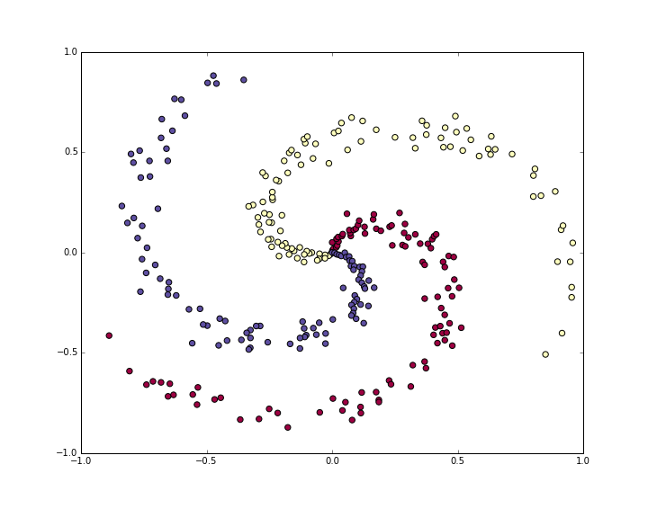
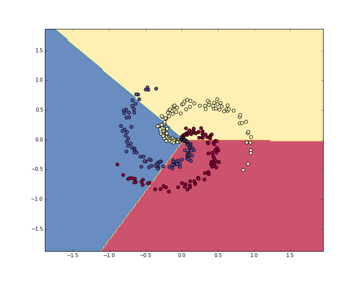
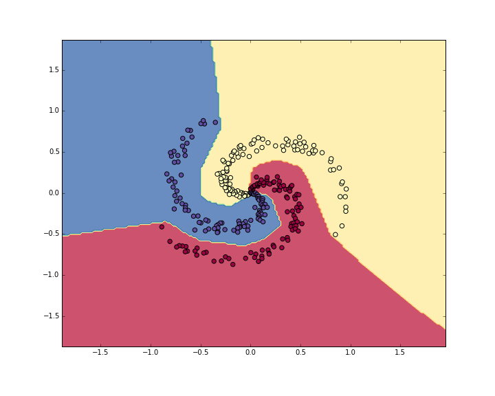

# 最小神经网络案例：从线性分类器到两层网络

[英文原文](neural-networks-case-study.md) · [逐步学习指南](../../docs/CS231n_2025_逐步学习实践指南.md)

> 本文按仓库英文原文翻译，保留完整计算步骤、公式与示例。示例代码中的 `print` 已改为 Python 3 写法；不涉及修改任何 Notebook 或作业实现。此例只在内存中生成几百个二维点，**不需要下载数据集或模型**。
>
> 把代码复制到自己新建的练习 Notebook 时，先运行 `import numpy as np` 和 `import matplotlib.pyplot as plt`。原文为突出推导而省略了数值稳定处理；实际使用时，在每次 `np.exp(scores)` 前先做 `scores = scores - scores.max(axis=1, keepdims=True)`。随机种子不同，结果也会有所不同，文中准确率只是示例。

## 目录

- [生成数据](#data)
- [训练 Softmax 线性分类器](#linear)
  - [初始化参数](#init)
  - [计算类别分数](#scores)
  - [计算损失](#loss)
  - [用反向传播计算解析梯度](#grad)
  - [更新参数](#update)
  - [组合成完整训练代码](#together)
- [训练神经网络](#net)
- [小结](#summary)

本节完整实现一个处理二维数据的小型神经网络。我们先实现简单的线性分类器，再把它扩展成两层神经网络。你会看到，这个扩展只需要修改很少的代码。

<a id="data"></a>

## 生成数据

我们希望构造一个不容易线性分开的分类数据集。螺旋数据是一个很好的例子，生成方法如下：

```python
N = 100 # number of points per class
D = 2 # dimensionality
K = 3 # number of classes
X = np.zeros((N*K,D)) # data matrix (each row = single example)
y = np.zeros(N*K, dtype='uint8') # class labels
for j in range(K):
  ix = range(N*j,N*(j+1))
  r = np.linspace(0.0,1,N) # radius
  t = np.linspace(j*4,(j+1)*4,N) + np.random.randn(N)*0.2 # theta
  X[ix] = np.c_[r*np.sin(t), r*np.cos(t)]
  y[ix] = j
# lets visualize the data:
plt.scatter(X[:, 0], X[:, 1], c=y, s=40, cmap=plt.cm.Spectral)
plt.show()
```



这组小型数据包含三类点，图中用蓝、红、黄区分，它们不是线性可分的。

一般应当预处理数据，让每个特征的均值为 0、标准差为 1。不过这里特征已经处于约 -1 到 1 的合适范围，因此跳过这一步。

<a id="linear"></a>

## 训练 Softmax 线性分类器

<a id="init"></a>

### 初始化参数

先在这个数据集上训练 Softmax 分类器。前文已经介绍过，它使用线性评分函数与交叉熵损失。模型参数包括权重矩阵 `W` 和偏置向量 `b`：权重随机初始化为小数，偏置初始化为 0。

```python
# initialize parameters randomly
W = 0.01 * np.random.randn(D,K)
b = np.zeros((1,K))
```

这里 `D = 2` 表示每个点的维度，`K = 3` 表示类别数。

<a id="scores"></a>

### 计算类别分数

线性分类器可以通过一次矩阵乘法，并行算出所有样本的类别分数：

```python
# compute class scores for a linear classifier
scores = np.dot(X, W) + b
```

数据共有 300 个二维点，因此 `scores` 的形状是 `[300, 3]`，每一行包含一个点属于三个类别的分数。

<a id="loss"></a>

### 计算损失

第二个关键部分是损失函数：它是一个可微的目标，用来衡量我们对分类分数的不满意程度。直观上，正确类别的分数应高于其他类别，此时损失应小；反之，损失应大。这里使用 Softmax 分类器对应的交叉熵损失。若 $f$ 是单个样本的类别分数向量，本例中包含 3 个数，那么该样本的损失为：

$$
L_i = -\log\left(\frac{e^{f_{y_i}}}{ \sum_j e^{f_j} }\right)
$$

Softmax 把 $f$ 的每个元素解释为对应类别的未归一化对数概率。先取指数，再归一化，就得到概率。因此对数里面是正确类别的预测概率，范围在 0 到 1 之间。这个概率趋近 0 时，损失趋向正无穷；趋近 1 时，因为 $\log(1)=0$，损失趋近 0。也就是说，正确类别的预测概率越高，损失越小。

完整目标是所有训练样本交叉熵的平均值，加上正则化损失：

$$
L =  \underbrace{ \frac{1}{N} \sum_i L_i }_\text{数据损失} + \underbrace{ \frac{1}{2} \lambda \sum_k\sum_l W_{k,l}^2 }_\text{正则化损失}
$$

利用上面的 `scores`，首先计算各个类别的预测概率：

```python
num_examples = X.shape[0]
# get unnormalized probabilities
exp_scores = np.exp(scores)
# normalize them for each example
probs = exp_scores / np.sum(exp_scores, axis=1, keepdims=True)
```

`probs` 的形状也是 `[300, 3]`，每一行是一组归一化类别概率，行和等于 1。接下来取出每个样本正确类别对应的负对数概率：

```python
correct_logprobs = -np.log(probs[range(num_examples),y])
```

`correct_logprobs` 是一维数组，每个元素是一个样本的**负对数概率**，不是概率本身。完整损失是这些值的平均数加上正则化项：

```python
# compute the loss: average cross-entropy loss and regularization
data_loss = np.sum(correct_logprobs)/num_examples
reg_loss = 0.5*reg*np.sum(W*W)
loss = data_loss + reg_loss
```

代码中的 `reg` 对应正则化强度 $\lambda$。正则化项前的 `0.5` 会在求导时简化表达式，稍后就能看到。

用较小的随机权重开始时，三个类别的预测概率都接近 $1/3$，所以初始损失约为 `-np.log(1.0/3)`，也就是 1.1 左右。我们希望尽量降低损失；它的下界是 0。损失越低，通常意味着模型给正确类别分配的概率越高。

<a id="grad"></a>

### 用反向传播计算解析梯度

现在能计算损失，接下来用梯度下降最小化它。从随机参数开始，计算损失对参数的梯度，就知道该怎样改变参数来降低损失。

引入中间变量 $p$ 表示归一化类别概率。单个样本的概率与损失为：

$$
p_k = \frac{e^{f_k}}{ \sum_j e^{f_j} } \hspace{1in} L_i =-\log\left(p_{y_i}\right)
$$

我们想知道，怎样改变分数向量 $f$，才能减小该样本对总目标的贡献 $L_i$。换句话说，要计算 $\partial L_i/\partial f_k$。损失依赖 $p$，而 $p$ 又依赖 $f$，所以可以使用链式法则。推导过程中许多项相消，最后得到：

$$
\frac{\partial L_i }{ \partial f_k } = p_k - \mathbb{1}(y_i = k)
$$

这个结果既简单又直观。例如预测概率为 `p = [0.2, 0.3, 0.5]`，正确类别是中间一类，则分数的梯度为 `df = [0.2, -0.7, 0.5]`。提高第一个或第三个错误类别的分数会增大损失，因此梯度为正；提高正确类别的分数会降低损失，因此对应梯度为负。

`probs` 的每一行保存一个样本的全部类别概率。下面计算分数梯度 `dscores`：

```python
dscores = probs
dscores[range(num_examples),y] -= 1
dscores /= num_examples
```

因为总数据损失取了样本平均值，梯度也要除以样本数。这里 `dscores = probs` 会共享数组，因此后续操作会改变 `probs`；如果还需要原概率，应改用 `probs.copy()`。

由 `scores = np.dot(X, W) + b`，可以继续反向传播到 `W` 和 `b`：

```python
dW = np.dot(X.T, dscores)
db = np.sum(dscores, axis=0, keepdims=True)
dW += reg*W # don't forget the regularization gradient
```

这里先对矩阵乘法反向传播，再加入正则化的贡献。由于损失中使用了系数 `0.5`，正则化梯度恰好是 `reg * W`：$\frac{d}{dw}(\frac12\lambda w^2)=\lambda w$。这是简化梯度表达式的常见技巧。

<a id="update"></a>

### 更新参数

梯度告诉我们每个参数如何影响损失。沿着**负梯度方向**更新参数，以降低损失：

```python
# perform a parameter update
W += -step_size * dW
b += -step_size * db
```

<a id="together"></a>

### 组合成完整训练代码

把以上步骤组合起来，就得到使用梯度下降训练 Softmax 分类器的完整代码：

```python
#Train a Linear Classifier

# initialize parameters randomly
W = 0.01 * np.random.randn(D,K)
b = np.zeros((1,K))

# some hyperparameters
step_size = 1e-0
reg = 1e-3 # regularization strength

# gradient descent loop
num_examples = X.shape[0]
for i in range(200):

  # evaluate class scores, [N x K]
  scores = np.dot(X, W) + b

  # compute the class probabilities
  exp_scores = np.exp(scores)
  probs = exp_scores / np.sum(exp_scores, axis=1, keepdims=True) # [N x K]

  # compute the loss: average cross-entropy loss and regularization
  correct_logprobs = -np.log(probs[range(num_examples),y])
  data_loss = np.sum(correct_logprobs)/num_examples
  reg_loss = 0.5*reg*np.sum(W*W)
  loss = data_loss + reg_loss
  if i % 10 == 0:
    print("iteration %d: loss %f" % (i, loss))

  # compute the gradient on scores
  dscores = probs
  dscores[range(num_examples),y] -= 1
  dscores /= num_examples

  # backpropate the gradient to the parameters (W,b)
  dW = np.dot(X.T, dscores)
  db = np.sum(dscores, axis=0, keepdims=True)

  dW += reg*W # regularization gradient

  # perform a parameter update
  W += -step_size * dW
  b += -step_size * db
```

原文示例输出如下：

```
iteration 0: loss 1.096956
iteration 10: loss 0.917265
iteration 20: loss 0.851503
iteration 30: loss 0.822336
iteration 40: loss 0.807586
iteration 50: loss 0.799448
iteration 60: loss 0.794681
iteration 70: loss 0.791764
iteration 80: loss 0.789920
iteration 90: loss 0.788726
iteration 100: loss 0.787938
iteration 110: loss 0.787409
iteration 120: loss 0.787049
iteration 130: loss 0.786803
iteration 140: loss 0.786633
iteration 150: loss 0.786514
iteration 160: loss 0.786431
iteration 170: loss 0.786373
iteration 180: loss 0.786331
iteration 190: loss 0.786302
```

约 190 次迭代后，损失已经基本收敛。可以计算训练集准确率：

```python
# evaluate training set accuracy
scores = np.dot(X, W) + b
predicted_class = np.argmax(scores, axis=1)
print('training accuracy: %.2f' % (np.mean(predicted_class == y)))
```

原文示例约为 **49%**。这个结果并不好，但并不意外，因为数据本来就不是线性可分的。把分类器学到的决策边界画出来，可以看到它无法沿着螺旋形状分割数据：



<a id="net"></a>

## 训练神经网络

线性分类器不适合这组数据。对于这样的小型数据集，增加一个隐藏层就足够了。现在第一层和第二层各需要一组权重与偏置：

```python
# initialize parameters randomly
h = 100 # size of hidden layer
W = 0.01 * np.random.randn(D,h)
b = np.zeros((1,h))
W2 = 0.01 * np.random.randn(h,K)
b2 = np.zeros((1,K))
```

计算分数的前向传播变为：

```python
# evaluate class scores with a 2-layer Neural Network
hidden_layer = np.maximum(0, np.dot(X, W) + b) # note, ReLU activation
scores = np.dot(hidden_layer, W2) + b2
```

与之前相比，只多了一行：先计算隐藏层表示，再根据它计算类别分数。关键在于添加了**非线性**，这里使用 ReLU，把隐藏层中小于 0 的激活值设成 0。

根据分数计算损失及其梯度 `dscores` 的方式不变。不过，梯度传播到模型参数的路径变长了。先反向传播经过第二层：其形式与线性分类器相同，只是把原始输入 `X` 换成了 `hidden_layer`。

```python
# backpropate the gradient to the parameters
# first backprop into parameters W2 and b2
dW2 = np.dot(hidden_layer.T, dscores)
db2 = np.sum(dscores, axis=0, keepdims=True)
```

此时还没有结束，因为 `hidden_layer` 本身也依赖其他参数和输入。先计算损失对隐藏层输出的梯度：

```python
dhidden = np.dot(dscores, W2.T)
```

再反向传播经过 ReLU。它在反向传播中相当于一个开关：对于 $r=\max(0,x)$，常用导数约定为 $dr/dx=\mathbb{1}(x>0)$。结合链式法则，输入大于 0 时梯度原样通过，输入小于等于 0 时梯度置零。因此可以直接写：

```python
# backprop the ReLU non-linearity
dhidden[hidden_layer <= 0] = 0
```

最后传播到第一层的权重和偏置：

```python
# finally into W,b
dW = np.dot(X.T, dhidden)
db = np.sum(dhidden, axis=0, keepdims=True)
```

现在已有 `dW, db, dW2, db2`，可以更新参数。其余步骤保持不变，完整代码如下：

```python
# initialize parameters randomly
h = 100 # size of hidden layer
W = 0.01 * np.random.randn(D,h)
b = np.zeros((1,h))
W2 = 0.01 * np.random.randn(h,K)
b2 = np.zeros((1,K))

# some hyperparameters
step_size = 1e-0
reg = 1e-3 # regularization strength

# gradient descent loop
num_examples = X.shape[0]
for i in range(10000):

  # evaluate class scores, [N x K]
  hidden_layer = np.maximum(0, np.dot(X, W) + b) # note, ReLU activation
  scores = np.dot(hidden_layer, W2) + b2

  # compute the class probabilities
  exp_scores = np.exp(scores)
  probs = exp_scores / np.sum(exp_scores, axis=1, keepdims=True) # [N x K]

  # compute the loss: average cross-entropy loss and regularization
  correct_logprobs = -np.log(probs[range(num_examples),y])
  data_loss = np.sum(correct_logprobs)/num_examples
  reg_loss = 0.5*reg*np.sum(W*W) + 0.5*reg*np.sum(W2*W2)
  loss = data_loss + reg_loss
  if i % 1000 == 0:
    print("iteration %d: loss %f" % (i, loss))

  # compute the gradient on scores
  dscores = probs
  dscores[range(num_examples),y] -= 1
  dscores /= num_examples

  # backpropate the gradient to the parameters
  # first backprop into parameters W2 and b2
  dW2 = np.dot(hidden_layer.T, dscores)
  db2 = np.sum(dscores, axis=0, keepdims=True)
  # next backprop into hidden layer
  dhidden = np.dot(dscores, W2.T)
  # backprop the ReLU non-linearity
  dhidden[hidden_layer <= 0] = 0
  # finally into W,b
  dW = np.dot(X.T, dhidden)
  db = np.sum(dhidden, axis=0, keepdims=True)

  # add regularization gradient contribution
  dW2 += reg * W2
  dW += reg * W

  # perform a parameter update
  W += -step_size * dW
  b += -step_size * db
  W2 += -step_size * dW2
  b2 += -step_size * db2
```

原文示例输出为：

```
iteration 0: loss 1.098744
iteration 1000: loss 0.294946
iteration 2000: loss 0.259301
iteration 3000: loss 0.248310
iteration 4000: loss 0.246170
iteration 5000: loss 0.245649
iteration 6000: loss 0.245491
iteration 7000: loss 0.245400
iteration 8000: loss 0.245335
iteration 9000: loss 0.245292
```

训练集准确率的计算也要包含隐藏层：

```python
# evaluate training set accuracy
hidden_layer = np.maximum(0, np.dot(X, W) + b)
scores = np.dot(hidden_layer, W2) + b2
predicted_class = np.argmax(scores, axis=1)
print('training accuracy: %.2f' % (np.mean(predicted_class == y)))
```

原文示例达到约 **98%**。决策边界能够贴合螺旋形状：



<a id="summary"></a>

## 小结

我们在同一个二维数据集上训练了线性分类器和两层神经网络。从前者扩展到后者，需要改动的代码很少：评分函数增加一层隐藏表示，反向传播再多经过一次隐藏层，最终到达第一层参数。

- 原作者示例的 [HTML 展示](http://cs.stanford.edu/people/karpathy/cs231nfiles/minimal_net.html)。
- 原作者示例的 [Notebook 下载](http://cs.stanford.edu/people/karpathy/cs231nfiles/minimal_net.ipynb)。仓库中的 Markdown 已包含本节代码，阅读本节无需另行下载。

英文原文归 Stanford CS231n / Andrej Karpathy 等原作者；本中文版本于 2026-11-05 整理。
