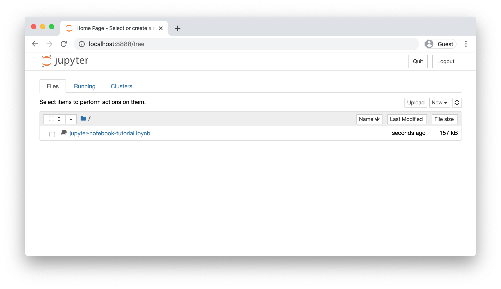
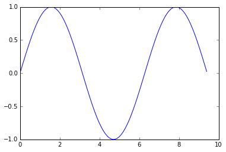
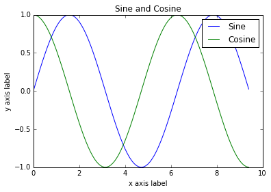
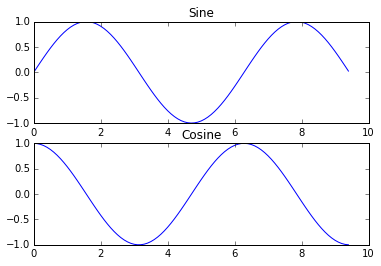
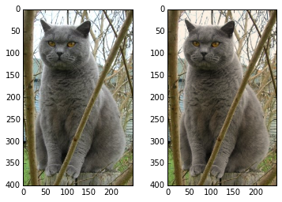

# Python 与 NumPy 教程（含 Jupyter、SciPy、Matplotlib）

[英文原文](python-numpy-tutorial.md) · [逐步学习指南](../../docs/CS231n_2025_逐步学习实践指南.md)

> 本地中文整理版（2026-11-05）：以仓库英文课程笔记为对照，参考智能单元社区译稿，统一了本地插图、公式与代码示例。函数名、变量名、论文标题及示例代码中的英文注释保留，便于查文档和对照作业。原笔记包含早期课程的经验与工具，历史建议不等同于 2025 年作业环境要求。

这篇教程由[Justin Johnson](http://cs.stanford.edu/people/jcjohns/)创作。

我们将使用Python编程语言来完成本课程的所有作业。Python是一门伟大的通用编程语言，在一些常用库（numpy, scipy, matplotlib）的帮助下，它又会变成一个强大的科学计算环境。

我们期望你们中大多数人对于Python语言和Numpy库比较熟悉，而对于没有Python经验的同学，这篇教程可以帮助你们快速了解Python编程环境和如何使用Python作为科学计算工具。

一部分同学对于Matlab有一定经验。对于这部分同学，我们推荐阅读 [numpy for Matlab users](https://numpy.org/doc/stable/user/numpy-for-matlab-users.html)页面。

## 本文目录

- [Jupyter 与 Colab Notebook](#section-01)
- [Python](#section-02)
  - [Python 版本](#section-03)
  - [基本数据类型](#section-04)
  - [容器（Containers）](#section-05)
    - [列表（Lists）](#section-06)
    - [字典（Dictionaries）](#section-07)
    - [集合（Sets）](#section-08)
    - [元组（Tuples）](#section-09)
  - [函数（Functions）](#section-10)
  - [类（Classes）](#section-11)
- [NumPy](#section-12)
  - [数组（Arrays）](#section-13)
  - [访问数组](#section-14)
  - [数据类型](#section-15)
  - [数组计算](#section-16)
  - [广播（Broadcasting）](#section-17)
  - [NumPy 文档](#section-18)
- [SciPy](#section-19)
  - [图像操作](#section-20)
  - [MATLAB 文件](#section-21)
  - [点之间的距离](#section-22)
- [Matplotlib](#section-23)
  - [绘图](#section-24)
  - [绘制多个图像](#section-25)
  - [图像](#section-26)

<a id="section-01"></a>

## Jupyter 与 Colab Notebook

在介绍 Python 之前，先认识 Notebook。Jupyter 允许你在浏览器中编写和执行**本地** Python 代码，按单元格分段试验，特别适合科学计算。Colab 是 Google 托管的 Notebook 服务，界面类似，但代码运行在远程机器上。

**本仓库的本地使用方式：** 激活 `cs231n` 环境，在仓库根目录启动 `jupyter lab` 或 `jupyter notebook`，打开已有的 [jupyter-notebook-tutorial.ipynb](jupyter-notebook-tutorial.ipynb)，并选择 `cs231n` 内核。本次仅翻译 Markdown，没有修改该 Notebook。



创建或打开一个 Notebook 后，在代码单元中输入表达式，用 `Shift+Enter` 执行。注意代码依赖当前内核里的变量：修改前面的定义后，通常要按顺序重跑后续单元；重启内核会清空内存状态。

英文原文还提供 [Colab 在线入口](https://colab.research.google.com/github/cs231n/cs231n.github.io/blob/master/python-colab.ipynb)，需要云端时可以使用。本地学习无需安装 `google.colab` 或挂载 Drive。环境的完整说明见[本地实验与存储管理](../../docs/本地实验与存储管理.md)。

本教程图片已在 `assets/` 中。要原样运行下方使用相对路径的图片示例，请把工作目录设为仓库的 `readings/notes/`；纯数组示例不依赖工作目录。

<a id="python"></a>

<a id="section-02"></a>

## Python

Python是一种高级的，动态类型的多范型编程语言。很多时候，大家会说Python看起来简直和伪代码一样，这是因为你能够通过很少行数的代码表达出很有力的思想。举个例子，下面是用Python实现的经典的quicksort算法例子：

```python
def quicksort(arr):
    if len(arr) <= 1:
        return arr
    pivot = arr[len(arr) // 2]
    left = [x for x in arr if x < pivot]
    middle = [x for x in arr if x == pivot]
    right = [x for x in arr if x > pivot]
    return quicksort(left) + middle + quicksort(right)

print(quicksort([3,6,8,10,1,2,1]))
# Prints "[1, 1, 2, 3, 6, 8, 10]"
```

<a id="section-03"></a>

### Python 版本

Python 2 已于 2020 年 1 月 1 日终止官方支持。英文教程中提到的 Python 3.7 也是历史版本要求；本仓库本地环境建议使用 **Python 3.10**，无需为了阅读此文创建 Python 2 环境。激活 `cs231n` 环境后，可以运行 `python --version` 检查版本。下面示例使用 Python 3 的 `print(...)`、`range(...)` 和字典 `items()`。

<a id="python-basic"></a>

<a id="section-04"></a>

### 基本数据类型

和大多数编程语言一样，Python拥有一系列的基本数据类型，比如整型、浮点型、布尔型和字符串等。这些类型的使用方式和在其他语言中的使用方式是类似的。

**数字**：整型和浮点型的使用与其他语言类似。

```python
x = 3
print(type(x)) # Prints "<class 'int'>"
print(x)       # Prints "3"
print(x + 1)   # Addition; prints "4"
print(x - 1)   # Subtraction; prints "2"
print(x * 2)   # Multiplication; prints "6"
print(x ** 2)  # Exponentiation; prints "9"
x += 1
print(x)  # Prints "4"
x *= 2
print(x)  # Prints "8"
y = 2.5
print(type(y)) # Prints "<class 'float'>"
print(y, y + 1, y * 2, y ** 2) # Prints "2.5 3.5 5.0 6.25"
```

需要注意的是，Python中没有 x++ 和 x-- 的操作符。

Python也有内置的长整型和复杂数字类型，具体细节可以查看[文档](https://docs.python.org/2/library/stdtypes.html#numeric-types-int-float-long-complex)。

**布尔型**：Python实现了所有的布尔逻辑，但用的是英语，而不是我们习惯的操作符（比如&&和||等）。

```python
t = True
f = False
print(type(t)) # Prints "<class 'bool'>"
print(t and f) # Logical AND; prints "False"
print(t or f)  # Logical OR; prints "True"
print(not t)   # Logical NOT; prints "False"
print(t != f)  # Logical XOR; prints "True"
```

**字符串**：Python对字符串的支持非常棒。

```python
hello = 'hello'    # String literals can use single quotes
world = "world"    # or double quotes; it does not matter.
print(hello)       # Prints "hello"
print(len(hello))  # String length; prints "5"
hw = hello + ' ' + world  # String concatenation
print(hw)  # prints "hello world"
hw12 = '%s %s %d' % (hello, world, 12)  # sprintf style string formatting
print(hw12)  # prints "hello world 12"
```

字符串对象有一系列有用的方法，比如：

```python
s = "hello"
print(s.capitalize())  # Capitalize a string; prints "Hello"
print(s.upper())       # Convert a string to uppercase; prints "HELLO"
print(s.rjust(7))      # Right-justify a string, padding with spaces; prints "  hello"
print(s.center(7))     # Center a string, padding with spaces; prints " hello "
print(s.replace('l', '(ell)'))  # Replace all instances of one substring with another;
                                # prints "he(ell)(ell)o"
print('  world '.strip())  # Strip leading and trailing whitespace; prints "world"
```

如果想详细查看字符串方法，请看[文档](https://docs.python.org/2/library/stdtypes.html#string-methods)。

<a id="python-containers"></a>

<a id="section-05"></a>

### 容器（Containers）

**译者注**：有知友建议container翻译为复合数据类型，供读者参考。

Python有以下几种容器类型：列表（lists）、字典（dictionaries）、集合（sets）和元组（tuples）。

<a id="python-lists"></a>

<a id="section-06"></a>

#### 列表（Lists）

列表就是Python中的数组，但是列表长度可变，且能包含不同类型元素。

```python
xs = [3, 1, 2]    # Create a list
print(xs, xs[2])  # Prints "[3, 1, 2] 2"
print(xs[-1])     # Negative indices count from the end of the list; prints "2"
xs[2] = 'foo'     # Lists can contain elements of different types
print(xs)         # Prints "[3, 1, 'foo']"
xs.append('bar')  # Add a new element to the end of the list
print(xs)         # Prints "[3, 1, 'foo', 'bar']"
x = xs.pop()      # Remove and return the last element of the list
print(x, xs)      # Prints "bar [3, 1, 'foo']"
```

列表的细节，同样可以查阅[文档](https://docs.python.org/2/tutorial/datastructures.html#more-on-lists)。

**切片Slicing**：为了一次性地获取列表中的元素，Python提供了一种简洁的语法，这就是切片。

```python
nums = list(range(5))     # range is a built-in function that creates a list of integers
print(nums)               # Prints "[0, 1, 2, 3, 4]"
print(nums[2:4])          # Get a slice from index 2 to 4 (exclusive); prints "[2, 3]"
print(nums[2:])           # Get a slice from index 2 to the end; prints "[2, 3, 4]"
print(nums[:2])           # Get a slice from the start to index 2 (exclusive); prints "[0, 1]"
print(nums[:])            # Get a slice of the whole list; prints "[0, 1, 2, 3, 4]"
print(nums[:-1])          # Slice indices can be negative; prints "[0, 1, 2, 3]"
nums[2:4] = [8, 9]        # Assign a new sublist to a slice
print(nums)               # Prints "[0, 1, 8, 9, 4]"
```

在Numpy数组的内容中，我们会再次看到切片语法。

**循环Loops**：我们可以这样遍历列表中的每一个元素：

```python
animals = ['cat', 'dog', 'monkey']
for animal in animals:
    print(animal)
# Prints "cat", "dog", "monkey", each on its own line.
```

如果想要在循环体内访问每个元素的指针，可以使用内置的**enumerate**函数

```python
animals = ['cat', 'dog', 'monkey']
for idx, animal in enumerate(animals):
    print('#%d: %s' % (idx + 1, animal))
# Prints "#1: cat", "#2: dog", "#3: monkey", each on its own line
```

**列表推导List comprehensions**：在编程的时候，我们常常想要将一种数据类型转换为另一种。下面是一个简单例子，将列表中的每个元素变成它的平方。

```python
nums = [0, 1, 2, 3, 4]
squares = []
for x in nums:
    squares.append(x ** 2)
print(squares)   # Prints [0, 1, 4, 9, 16]
```

使用列表推导，你就可以让代码简化很多：

```python
nums = [0, 1, 2, 3, 4]
squares = [x ** 2 for x in nums]
print(squares)   # Prints [0, 1, 4, 9, 16]
```

列表推导还可以包含条件：

```python
nums = [0, 1, 2, 3, 4]
even_squares = [x ** 2 for x in nums if x % 2 == 0]
print(even_squares)  # Prints "[0, 4, 16]"
```

<a id="python-dicts"></a>

<a id="section-07"></a>

#### 字典（Dictionaries）

字典用来储存（键, 值）对，这和Java中的Map差不多。你可以这样使用它：

```python
d = {'cat': 'cute', 'dog': 'furry'}  # Create a new dictionary with some data
print(d['cat'])       # Get an entry from a dictionary; prints "cute"
print('cat' in d)     # Check if a dictionary has a given key; prints "True"
d['fish'] = 'wet'     # Set an entry in a dictionary
print(d['fish'])      # Prints "wet"
# print(d['monkey'])  # KeyError: 'monkey' not a key of d
print(d.get('monkey', 'N/A'))  # Get an element with a default; prints "N/A"
print(d.get('fish', 'N/A'))    # Get an element with a default; prints "wet"
del d['fish']         # Remove an element from a dictionary
print(d.get('fish', 'N/A')) # "fish" is no longer a key; prints "N/A"
```

想要知道字典的其他特性，请查阅[文档](https://docs.python.org/2/library/stdtypes.html#dict)。

**循环Loops**：在字典中，用键来迭代更加容易。

```python
d = {'person': 2, 'cat': 4, 'spider': 8}
for animal in d:
    legs = d[animal]
    print('A %s has %d legs' % (animal, legs))
# Prints "A person has 2 legs", "A cat has 4 legs", "A spider has 8 legs"
```

如果你想要访问键和对应的值，那就使用**iteritems**方法：

```python
d = {'person': 2, 'cat': 4, 'spider': 8}
for animal, legs in d.items():
    print('A %s has %d legs' % (animal, legs))
# Prints "A person has 2 legs", "A cat has 4 legs", "A spider has 8 legs"
```

**字典推导Dictionary comprehensions**：和列表推导类似，但是允许你方便地构建字典。

```python
nums = [0, 1, 2, 3, 4]
even_num_to_square = {x: x ** 2 for x in nums if x % 2 == 0}
print(even_num_to_square)  # Prints "{0: 0, 2: 4, 4: 16}"
```

<a id="python-sets"></a>

<a id="section-08"></a>

#### 集合（Sets）

集合是独立不同个体的无序集合。示例如下：

```python
animals = {'cat', 'dog'}
print('cat' in animals)   # Check if an element is in a set; prints "True"
print('fish' in animals)  # prints "False"
animals.add('fish')       # Add an element to a set
print('fish' in animals)  # Prints "True"
print(len(animals))       # Number of elements in a set; prints "3"
animals.add('cat')        # Adding an element that is already in the set does nothing
print(len(animals))       # Prints "3"
animals.remove('cat')     # Remove an element from a set
print(len(animals))       # Prints "2"
```

和前面一样，要知道更详细的，查看[文档](https://docs.python.org/2/library/sets.html#set-objects)。

**循环Loops**：在集合中循环的语法和在列表中一样，但是集合是无序的，所以你在访问集合的元素的时候，不能做关于顺序的假设。

```python
animals = {'cat', 'dog', 'fish'}
for idx, animal in enumerate(animals):
    print('#%d: %s' % (idx + 1, animal))
# Prints "#1: fish", "#2: dog", "#3: cat"
```

**集合推导（Set comprehensions）**：和字典推导一样，可以很方便地构建集合：

```python
from math import sqrt
nums = {int(sqrt(x)) for x in range(30)}
print(nums)  # Prints "{0, 1, 2, 3, 4, 5}"
```

<a id="python-tuples"></a>

<a id="section-09"></a>

#### 元组（Tuples）

元组是一个值的有序列表（不可改变）。从很多方面来说，元组和列表都很相似。和列表最重要的不同在于，元组可以在字典中用作键，还可以作为集合的元素，而列表不行。例子如下：

```python
d = {(x, x + 1): x for x in range(10)}  # Create a dictionary with tuple keys
t = (5, 6)        # Create a tuple
print(type(t))    # Prints "<class 'tuple'>"
print(d[t])       # Prints "5"
print(d[(1, 2)])  # Prints "1"
```

[文档](https://docs.python.org/2/tutorial/datastructures.html#tuples-and-sequences)有更多元组的信息。

<a id="python-functions"></a>

<a id="section-10"></a>

### 函数（Functions）

Python函数使用def来定义函数：

```python
def sign(x):
    if x > 0:
        return 'positive'
    elif x < 0:
        return 'negative'
    else:
        return 'zero'

for x in [-1, 0, 1]:
    print(sign(x))
# Prints "negative", "zero", "positive"
```

我们常常使用可选参数来定义函数：

```python
def hello(name, loud=False):
    if loud:
        print('HELLO, %s!' % name.upper())
    else:
        print('Hello, %s' % name)

hello('Bob') # Prints "Hello, Bob"
hello('Fred', loud=True)  # Prints "HELLO, FRED!"
```

函数还有很多内容，可以查看[文档](https://docs.python.org/2/tutorial/controlflow.html#defining-functions)。

<a id="python-classes"></a>

<a id="section-11"></a>

### 类（Classes）

Python对于类的定义是简单直接的：

```python
class Greeter(object):

    # Constructor
    def __init__(self, name):
        self.name = name  # Create an instance variable

    # Instance method
    def greet(self, loud=False):
        if loud:
            print('HELLO, %s!' % self.name.upper())
        else:
            print('Hello, %s' % self.name)

g = Greeter('Fred')  # Construct an instance of the Greeter class
g.greet()            # Call an instance method; prints "Hello, Fred"
g.greet(loud=True)   # Call an instance method; prints "HELLO, FRED!"
```

更多类的信息请查阅[文档](https://docs.python.org/2/tutorial/classes.html)。

Numpy是Python中用于科学计算的核心库。它提供了高性能的多维数组对象，以及相关工具。

<a id="numpy"></a>

<a id="section-12"></a>

## NumPy

<a id="numpy-arrays"></a>

<a id="section-13"></a>

### 数组（Arrays）

一个numpy数组是一个由不同数值组成的网格。网格中的数据都是同一种数据类型，可以通过非负整型数的元组来访问。维度的数量被称为数组的阶，数组的大小是一个由整型数构成的元组，可以描述数组不同维度上的大小。

我们可以从列表创建数组，然后利用方括号访问其中的元素：

```python
import numpy as np

a = np.array([1, 2, 3])   # Create a rank 1 array
print(type(a))            # Prints "<class 'numpy.ndarray'>"
print(a.shape)            # Prints "(3,)"
print(a[0], a[1], a[2])   # Prints "1 2 3"
a[0] = 5                  # Change an element of the array
print(a)                  # Prints "[5, 2, 3]"

b = np.array([[1,2,3],[4,5,6]])    # Create a rank 2 array
print(b.shape)                     # Prints "(2, 3)"
print(b[0, 0], b[0, 1], b[1, 0])   # Prints "1 2 4"
```

Numpy还提供了很多其他创建数组的方法：

```python
import numpy as np

a = np.zeros((2,2))   # Create an array of all zeros
print(a)              # Prints "[[ 0.  0.]
                      #          [ 0.  0.]]"

b = np.ones((1,2))    # Create an array of all ones
print(b)              # Prints "[[ 1.  1.]]"

c = np.full((2,2), 7)  # Create a constant array
print(c)               # Prints "[[ 7.  7.]
                       #          [ 7.  7.]]"

d = np.eye(2)         # Create a 2x2 identity matrix
print(d)              # Prints "[[ 1.  0.]
                      #          [ 0.  1.]]"

e = np.random.random((2,2))  # Create an array filled with random values
print(e)                     # Might print "[[ 0.91940167  0.08143941]
                             #               [ 0.68744134  0.87236687]]"
```

其他数组相关方法，请查看[文档](http://docs.scipy.org/doc/numpy/user/basics.creation.html#arrays-creation)。

<a id="numpy-array-indexing"></a>

<a id="section-14"></a>

### 访问数组

Numpy提供了多种访问数组的方法。

**切片**：和Python列表类似，numpy数组可以使用切片语法。因为数组可以是多维的，所以你**必须**为每个维度指定好切片。

```python
import numpy as np

# Create the following rank 2 array with shape (3, 4)
# [[ 1  2  3  4]
#  [ 5  6  7  8]
#  [ 9 10 11 12]]
a = np.array([[1,2,3,4], [5,6,7,8], [9,10,11,12]])

# Use slicing to pull out the subarray consisting of the first 2 rows
# and columns 1 and 2; b is the following array of shape (2, 2):
# [[2 3]
#  [6 7]]
b = a[:2, 1:3]

# A slice of an array is a view into the same data, so modifying it
# will modify the original array.
print(a[0, 1])   # Prints "2"
b[0, 0] = 77     # b[0, 0] is the same piece of data as a[0, 1]
print(a[0, 1])   # Prints "77"
```

你可以同时使用整型和切片语法来访问数组。但是，这样做会产生一个比原数组低阶的新数组。需要注意的是，这里和MATLAB中的情况是不同的：

```python
import numpy as np

# Create the following rank 2 array with shape (3, 4)
# [[ 1  2  3  4]
#  [ 5  6  7  8]
#  [ 9 10 11 12]]
a = np.array([[1,2,3,4], [5,6,7,8], [9,10,11,12]])

# Two ways of accessing the data in the middle row of the array.
# Mixing integer indexing with slices yields an array of lower rank,
# while using only slices yields an array of the same rank as the
# original array:
row_r1 = a[1, :]    # Rank 1 view of the second row of a
row_r2 = a[1:2, :]  # Rank 2 view of the second row of a
print(row_r1, row_r1.shape)  # Prints "[5 6 7 8] (4,)"
print(row_r2, row_r2.shape)  # Prints "[[5 6 7 8]] (1, 4)"

# We can make the same distinction when accessing columns of an array:
col_r1 = a[:, 1]
col_r2 = a[:, 1:2]
print(col_r1, col_r1.shape)  # Prints "[ 2  6 10] (3,)"
print(col_r2, col_r2.shape)  # Prints "[[ 2]
                             #          [ 6]
                             #          [10]] (3, 1)"
```

**整型数组访问**：当我们使用切片语法访问数组时，得到的总是原数组的一个子集。整型数组访问允许我们利用其它数组的数据构建一个新的数组：

```python
import numpy as np

a = np.array([[1,2], [3, 4], [5, 6]])

# An example of integer array indexing.
# The returned array will have shape (3,) and
print(a[[0, 1, 2], [0, 1, 0]])  # Prints "[1 4 5]"

# The above example of integer array indexing is equivalent to this:
print(np.array([a[0, 0], a[1, 1], a[2, 0]]))  # Prints "[1 4 5]"

# When using integer array indexing, you can reuse the same
# element from the source array:
print(a[[0, 0], [1, 1]])  # Prints "[2 2]"

# Equivalent to the previous integer array indexing example
print(np.array([a[0, 1], a[0, 1]]))  # Prints "[2 2]"
```

整型数组访问语法还有个有用的技巧，可以用来选择或者更改矩阵中每行中的一个元素：

```python
import numpy as np

# Create a new array from which we will select elements
a = np.array([[1,2,3], [4,5,6], [7,8,9], [10, 11, 12]])

print(a)  # prints "array([[ 1,  2,  3],
          #                [ 4,  5,  6],
          #                [ 7,  8,  9],
          #                [10, 11, 12]])"

# Create an array of indices
b = np.array([0, 2, 0, 1])

# Select one element from each row of a using the indices in b
print(a[np.arange(4), b])  # Prints "[ 1  6  7 11]"

# Mutate one element from each row of a using the indices in b
a[np.arange(4), b] += 10

print(a)  # prints "array([[11,  2,  3],
          #                [ 4,  5, 16],
          #                [17,  8,  9],
          #                [10, 21, 12]])
```

**布尔型数组访问**：布尔型数组访问可以让你选择数组中任意元素。通常，这种访问方式用于选取数组中满足某些条件的元素，举例如下：

```python
import numpy as np

a = np.array([[1,2], [3, 4], [5, 6]])

bool_idx = (a > 2)   # Find the elements of a that are bigger than 2;
                     # this returns a numpy array of Booleans of the same
                     # shape as a, where each slot of bool_idx tells
                     # whether that element of a is > 2.

print(bool_idx)      # Prints "[[False False]
                     #          [ True  True]
                     #          [ True  True]]"

# We use boolean array indexing to construct a rank 1 array
# consisting of the elements of a corresponding to the True values
# of bool_idx
print(a[bool_idx])  # Prints "[3 4 5 6]"

# We can do all of the above in a single concise statement:
print(a[a > 2])     # Prints "[3 4 5 6]"
```

为了教程的简介，有很多数组访问的细节我们没有详细说明，可以查看[文档](http://docs.scipy.org/doc/numpy/reference/arrays.indexing.html)。

<a id="numpy-datatypes"></a>

<a id="section-15"></a>

### 数据类型

每个Numpy数组都是数据类型相同的元素组成的网格。Numpy提供了很多的数据类型用于创建数组。当你创建数组的时候，Numpy会尝试猜测数组的数据类型，你也可以通过参数直接指定数据类型，例子如下：

```python
import numpy as np

x = np.array([1, 2])   # Let numpy choose the datatype
print(x.dtype)         # Prints "int64"

x = np.array([1.0, 2.0])   # Let numpy choose the datatype
print(x.dtype)             # Prints "float64"

x = np.array([1, 2], dtype=np.int64)   # Force a particular datatype
print(x.dtype)                         # Prints "int64"
```

更多细节查看[文档](http://docs.scipy.org/doc/numpy/reference/arrays.dtypes.html)。

<a id="numpy-math"></a>

<a id="section-16"></a>

### 数组计算

基本数学计算函数会对数组中元素逐个进行计算，既可以利用操作符重载，也可以使用函数方式：

```python
import numpy as np

x = np.array([[1,2],[3,4]], dtype=np.float64)
y = np.array([[5,6],[7,8]], dtype=np.float64)

# Elementwise sum; both produce the array
# [[ 6.0  8.0]
#  [10.0 12.0]]
print(x + y)
print(np.add(x, y))

# Elementwise difference; both produce the array
# [[-4.0 -4.0]
#  [-4.0 -4.0]]
print(x - y)
print(np.subtract(x, y))

# Elementwise product; both produce the array
# [[ 5.0 12.0]
#  [21.0 32.0]]
print(x * y)
print(np.multiply(x, y))

# Elementwise division; both produce the array
# [[ 0.2         0.33333333]
#  [ 0.42857143  0.5       ]]
print(x / y)
print(np.divide(x, y))

# Elementwise square root; produces the array
# [[ 1.          1.41421356]
#  [ 1.73205081  2.        ]]
print(np.sqrt(x))
```

和MATLAB不同，*是元素逐个相乘，而不是矩阵乘法。在Numpy中使用dot来进行矩阵乘法：

```python
import numpy as np

x = np.array([[1,2],[3,4]])
y = np.array([[5,6],[7,8]])

v = np.array([9,10])
w = np.array([11, 12])

# Inner product of vectors; both produce 219
print(v.dot(w))
print(np.dot(v, w))

# Matrix / vector product; both produce the rank 1 array [29 67]
print(x.dot(v))
print(np.dot(x, v))

# Matrix / matrix product; both produce the rank 2 array
# [[19 22]
#  [43 50]]
print(x.dot(y))
print(np.dot(x, y))
```

Numpy提供了很多计算数组的函数，其中最常用的一个是**sum**：

```python
import numpy as np

x = np.array([[1,2],[3,4]])

print(np.sum(x))  # Compute sum of all elements; prints "10"
print(np.sum(x, axis=0))  # Compute sum of each column; prints "[4 6]"
print(np.sum(x, axis=1))  # Compute sum of each row; prints "[3 7]"
```

想要了解更多函数，可以查看[文档](http://docs.scipy.org/doc/numpy/reference/routines.math.html)。

除了计算，我们还常常改变数组或者操作其中的元素。其中将矩阵转置是常用的一个，在Numpy中，使用**T**来转置矩阵：

```python
import numpy as np

x = np.array([[1,2], [3,4]])
print(x)    # Prints "[[1 2]
            #          [3 4]]"
print(x.T)  # Prints "[[1 3]
            #          [2 4]]"

# Note that taking the transpose of a rank 1 array does nothing:
v = np.array([1,2,3])
print(v)    # Prints "[1 2 3]"
print(v.T)  # Prints "[1 2 3]"
```

Numpy还提供了更多操作数组的方法，请查看[文档](http://docs.scipy.org/doc/numpy/reference/routines.array-manipulation.html)。

<a id="numpy-broadcasting"></a>

<a id="section-17"></a>

### 广播（Broadcasting）

广播是一种强有力的机制，它让Numpy可以让不同大小的矩阵在一起进行数学计算。我们常常会有一个小的矩阵和一个大的矩阵，然后我们会需要用小的矩阵对大的矩阵做一些计算。

举个例子，如果我们想要把一个向量加到矩阵的每一行，我们可以这样做：

```python
import numpy as np

# We will add the vector v to each row of the matrix x,
# storing the result in the matrix y
x = np.array([[1,2,3], [4,5,6], [7,8,9], [10, 11, 12]])
v = np.array([1, 0, 1])
y = np.empty_like(x)   # Create an empty matrix with the same shape as x

# Add the vector v to each row of the matrix x with an explicit loop
for i in range(4):
    y[i, :] = x[i, :] + v

# Now y is the following
# [[ 2  2  4]
#  [ 5  5  7]
#  [ 8  8 10]
#  [11 11 13]]
print(y)
```

这样是行得通的，但是当x矩阵非常大，利用循环来计算就会变得很慢很慢。我们可以换一种思路：

```python
import numpy as np

# We will add the vector v to each row of the matrix x,
# storing the result in the matrix y
x = np.array([[1,2,3], [4,5,6], [7,8,9], [10, 11, 12]])
v = np.array([1, 0, 1])
vv = np.tile(v, (4, 1))   # Stack 4 copies of v on top of each other
print(vv)                 # Prints "[[1 0 1]
                          #          [1 0 1]
                          #          [1 0 1]
                          #          [1 0 1]]"
y = x + vv  # Add x and vv elementwise
print(y)  # Prints "[[ 2  2  4
          #          [ 5  5  7]
          #          [ 8  8 10]
          #          [11 11 13]]"
```

Numpy广播机制可以让我们不用创建vv，就能直接运算，看看下面例子：

```python
import numpy as np

# We will add the vector v to each row of the matrix x,
# storing the result in the matrix y
x = np.array([[1,2,3], [4,5,6], [7,8,9], [10, 11, 12]])
v = np.array([1, 0, 1])
y = x + v  # Add v to each row of x using broadcasting
print(y)  # Prints "[[ 2  2  4]
          #          [ 5  5  7]
          #          [ 8  8 10]
          #          [11 11 13]]"
```

对两个数组使用广播机制要遵守下列规则：

1. 如果数组的维数不同，使用1来将维数较小的数组进行扩展，直到两个数组的尺寸的长度都一样。
2. 如果两个数组在某个维度上的长度是一样的，或者其中一个数组在该维度上长度为1，那么我们就说这两个数组在该维度上是**相容**的。
3. 如果两个数组在所有维度上都是相容的，他们就能使用广播。
4. 如果两个输入数组的尺寸不同，那么注意其中较大的那个尺寸。因为广播之后，两个数组的尺寸将和那个较大的尺寸一样。
5. 在任何一个维度上，如果一个数组的长度为1，另一个数组长度大于1，那么在该维度上，就好像是对第一个数组进行了复制。

如果上述解释看不明白，可以读一读[文档](http://docs.scipy.org/doc/numpy/user/basics.broadcasting.html)和这个[解释](http://scipy.github.io/old-wiki/pages/EricsBroadcastingDoc)。**译者注**：强烈推荐阅读文档中的例子。

支持广播机制的函数是全局函数。哪些是全局函数可以在[文档](http://docs.scipy.org/doc/numpy/reference/ufuncs.html#available-ufuncs)中查找。

下面是一些广播机制的使用：

```python
import numpy as np

# Compute outer product of vectors
v = np.array([1,2,3])  # v has shape (3,)
w = np.array([4,5])    # w has shape (2,)
# To compute an outer product, we first reshape v to be a column
# vector of shape (3, 1); we can then broadcast it against w to yield
# an output of shape (3, 2), which is the outer product of v and w:
# [[ 4  5]
#  [ 8 10]
#  [12 15]]
print(np.reshape(v, (3, 1)) * w)

# Add a vector to each row of a matrix
x = np.array([[1,2,3], [4,5,6]])
# x has shape (2, 3) and v has shape (3,) so they broadcast to (2, 3),
# giving the following matrix:
# [[2 4 6]
#  [5 7 9]]
print(x + v)

# Add a vector to each column of a matrix
# x has shape (2, 3) and w has shape (2,).
# If we transpose x then it has shape (3, 2) and can be broadcast
# against w to yield a result of shape (3, 2); transposing this result
# yields the final result of shape (2, 3) which is the matrix x with
# the vector w added to each column. Gives the following matrix:
# [[ 5  6  7]
#  [ 9 10 11]]
print((x.T + w).T)
# Another solution is to reshape w to be a column vector of shape (2, 1);
# we can then broadcast it directly against x to produce the same
# output.
print(x + np.reshape(w, (2, 1)))

# Multiply a matrix by a constant:
# x has shape (2, 3). Numpy treats scalars as arrays of shape ();
# these can be broadcast together to shape (2, 3), producing the
# following array:
# [[ 2  4  6]
#  [ 8 10 12]]
print(x * 2)
```

广播机制能够让你的代码更简洁更迅速，能够用的时候请尽量使用！

<a id="section-18"></a>

### NumPy 文档

这篇教程涉及了你需要了解的numpy中的一些重要内容，但是numpy远不止如此。可以查阅[numpy文献](http://docs.scipy.org/doc/numpy/reference/)来学习更多。

Numpy提供了高性能的多维数组，以及计算和操作数组的基本工具。[SciPy](http://docs.scipy.org/doc/scipy/reference/)基于Numpy，提供了大量的计算和操作数组的函数，这些函数对于不同类型的科学和工程计算非常有用。

熟悉SciPy的最好方法就是阅读[文档](http://docs.scipy.org/doc/scipy/reference/index.html)。我们会强调对于本课程有用的部分。

<a id="scipy"></a>

<a id="section-19"></a>

## SciPy

<a id="scipy-image"></a>

<a id="section-20"></a>

### 图像操作

旧教程使用 `scipy.misc.imread`、`imsave` 和 `imresize` 读取、保存和缩放图像。这些接口已从现代 SciPy 移除；当前环境可使用 Pillow 或 imageio。下面把相应示例改写为 Pillow。若环境尚未提供 Pillow，再按需执行 `python -m pip install pillow`；这不是学习基本数组操作的前置要求。

读取图片为 NumPy 数组后，可以用广播独立缩放三个颜色通道，再调整图像尺寸。图像转回 `uint8` 前先把值限制到 0–255 范围。

```python
from pathlib import Path
import numpy as np
from PIL import Image

img = np.array(Image.open('assets/cat.jpg').convert('RGB'))
print(img.dtype, img.shape)

# 广播缩放 RGB 通道：红色不变，绿色乘 0.95，蓝色乘 0.9。
img_tinted = np.clip(img * [1, 0.95, 0.9], 0, 255).astype(np.uint8)
img_tinted = Image.fromarray(img_tinted).resize((300, 300))

# 仅把实验输出写入 results，不覆盖仓库中的原始插图。
output_dir = Path('../../results/tutorial')
output_dir.mkdir(parents=True, exist_ok=True)
img_tinted.save(output_dir / 'cat_tinted.jpg')
```

**译者注**：如果运行这段代码出现类似**ImportError: cannot import name imread**的报错，那么请利用pip进行Pillow的下载，可以解决问题。命令：pip install Pillow。


左边是原始图片，右边是变色和变形的图片。

<a id="scipy-matlab"></a>

<a id="section-21"></a>

### MATLAB 文件

函数**scipy.io.loadmat**和**scipy.io.savemat**能够让你读和写MATLAB文件。具体请查看[文档](http://docs.scipy.org/doc/scipy/reference/io.html)。

<a id="scipy-dist"></a>

<a id="section-22"></a>

### 点之间的距离

SciPy定义了一些有用的函数，可以计算集合中点之间的距离。

函数**scipy.spatial.distance.pdist**能够计算集合中所有两点之间的距离：

```python
import numpy as np
from scipy.spatial.distance import pdist, squareform

# Create the following array where each row is a point in 2D space:
# [[0 1]
#  [1 0]
#  [2 0]]
x = np.array([[0, 1], [1, 0], [2, 0]])
print(x)

# Compute the Euclidean distance between all rows of x.
# d[i, j] is the Euclidean distance between x[i, :] and x[j, :],
# and d is the following array:
# [[ 0.          1.41421356  2.23606798]
#  [ 1.41421356  0.          1.        ]
#  [ 2.23606798  1.          0.        ]]
d = squareform(pdist(x, 'euclidean'))
print(d)
```

具体细节请阅读[文档](http://docs.scipy.org/doc/scipy/reference/generated/scipy.spatial.distance.pdist.html)。

函数**scipy.spatial.distance.cdist**可以计算不同集合中点的距离，具体请查看[文档](http://docs.scipy.org/doc/scipy/reference/generated/scipy.spatial.distance.cdist.html)。

<a id="matplotlib"></a>

<a id="section-23"></a>

## Matplotlib

Matplotlib是一个作图库。这里简要介绍**matplotlib.pyplot**模块，功能和MATLAB的作图功能类似。

<a id="matplotlib-plotting"></a>

<a id="section-24"></a>

### 绘图

matplotlib库中最重要的函数是**Plot**。该函数允许你做出2D图形，如下：

```python
import numpy as np
import matplotlib.pyplot as plt

# Compute the x and y coordinates for points on a sine curve
x = np.arange(0, 3 * np.pi, 0.1)
y = np.sin(x)

# Plot the points using matplotlib
plt.plot(x, y)
plt.show()  # You must call plt.show() to make graphics appear.
```

运行上面代码会产生下面的作图：



只需要少量工作，就可以一次画不同的线，加上标签，坐标轴标志等。

```python
import numpy as np
import matplotlib.pyplot as plt

# Compute the x and y coordinates for points on sine and cosine curves
x = np.arange(0, 3 * np.pi, 0.1)
y_sin = np.sin(x)
y_cos = np.cos(x)

# Plot the points using matplotlib
plt.plot(x, y_sin)
plt.plot(x, y_cos)
plt.xlabel('x axis label')
plt.ylabel('y axis label')
plt.title('Sine and Cosine')
plt.legend(['Sine', 'Cosine'])
plt.show()
```



可以在[文档](http://matplotlib.org/api/pyplot_api.html#matplotlib.pyplot.plot)中阅读更多关于plot的内容。

<a id="matplotlib-subplots"></a>

<a id="section-25"></a>

### 绘制多个图像

可以使用**subplot**函数来在一幅图中画不同的东西：

```python
import numpy as np
import matplotlib.pyplot as plt

# Compute the x and y coordinates for points on sine and cosine curves
x = np.arange(0, 3 * np.pi, 0.1)
y_sin = np.sin(x)
y_cos = np.cos(x)

# Set up a subplot grid that has height 2 and width 1,
# and set the first such subplot as active.
plt.subplot(2, 1, 1)

# Make the first plot
plt.plot(x, y_sin)
plt.title('Sine')

# Set the second subplot as active, and make the second plot.
plt.subplot(2, 1, 2)
plt.plot(x, y_cos)
plt.title('Cosine')

# Show the figure.
plt.show()
```



关于**subplot**的更多细节，可以阅读[文档](http://matplotlib.org/api/pyplot_api.html#matplotlib.pyplot.subplot)。

<a id="matplotlib-images"></a>

<a id="section-26"></a>

### 图像

你可以使用**imshow**函数来显示图像，如下所示：

```python
import numpy as np
from PIL import Image
import matplotlib.pyplot as plt

img = np.array(Image.open('assets/cat.jpg').convert('RGB'))
img_tinted = np.clip(img * [1, 0.95, 0.9], 0, 255).astype(np.uint8)

plt.subplot(1, 2, 1)
plt.imshow(img)
plt.title('Original')
plt.axis('off')

plt.subplot(1, 2, 2)
plt.imshow(img_tinted)
plt.title('Tinted')
plt.axis('off')
plt.show()
```



## 译稿来源与署名

英文原作者及课程归 Stanford CS231n / Andrej Karpathy 等原作者。以下保留社区译者和校对者署名；本页经过本地排版、合并、兼容性整理与补充，不代表原作者另行审核。

- [社区译文原始页面](https://zhuanlan.zhihu.com/p/20878530)：**译者注**：本文[智能单元](https://zhuanlan.zhihu.com/intelligentunit)首发，翻译自斯坦福CS231n课程笔记[Python Numpy Tutorial](https://cs231n.github.io/python-numpy-tutorial/)，由课程教师[Andrej Karpathy](http://cs.stanford.edu/people/karpathy/)授权进行翻译。本篇教程由[杜客](https://www.zhihu.com/people/du-ke)翻译完成，[Flood Sung](https://www.zhihu.com/people/flood-sung)、[SunisDown](https://www.zhihu.com/people/sunisdown)、[巩子嘉](https://www.zhihu.com/people/gong-zi-jia-57)和一位不愿透露ID的知友对本翻译亦有贡献。

社区译稿存档：[whyscience/CS231n-Note-Translation_CN](https://github.com/whyscience/CS231n-Note-Translation_CN/tree/73a4638b231301f21e2373babdac60b66be53ca9)。本地英文原文保留，遇到术语或历史实现差异时可对照阅读。
